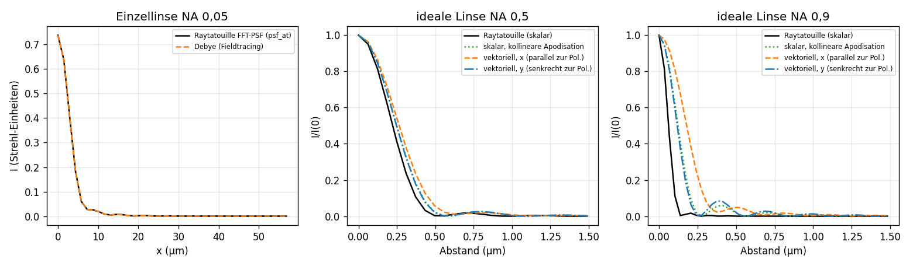

# Vergleich: Debye-PSF aus Raytatouille-Strahlen gegen Raytatouilles FFT-PSF (#25)

Raytatouille am Commit aus `rtt-commit.txt`. Fieldtracing-Weg (`rtt_bridge.debye_psf`):
`HexapolarPupil` (Rand eingeschlossen) → `trace_field` auf eine Ebene im Bildraum (Phase k₀·OPL,
Amplitude nach ADR 0004 mit Maschen-Jacobi, x-polarisierter Eingang) → `chain.debye` auf die
Bildebene (Gl. debye, vektoriell, Referenzkugel um den Schnittpunkt des Hauptstrahls mit der
Bildfläche) → Strehl gegen dasselbe Integral ohne Aberration. Raytatouille: `analysis.psf`
(Strehl) und `analysis.psf_at` (direkte Summe über die Pupillenzellen, Strehl-Einheiten) mit
`grid = 256`. Skript: `experiments/vergleich_psf.py`, Tests: `tests/test_rtt_psf.py` (Marker
`rtt`).

## Kleine NA: Übereinstimmung

Plankonvexe Einzellinse f = 100 mm, D = 10 mm, NA 0,05, Vakuum, Bild im paraxialen Fokus
(Raytatouille `m6/planoconvex_f10`, sphärische Aberration):

| Größe | Fieldtracing (Debye, vektoriell) | Raytatouille (FFT, skalar) |
| --- | --- | --- |
| Strehl | 0,73820 | 0,73815 |
| Profil längs x und y bis 57 µm (≈ 8 Airy-Radien) | max. Abweichung 1,7·10⁻⁴ Strehl-Einheiten | |

Die beiden Wege stimmen bis auf die Diskretisierung überein. Erwartet war das: Bei NA 0,05 sind
cos θ ≥ 0,9987, die z-Komponente und die Apodisation spielen keine Rolle, und die
Fresnel-Zahl N_F ≈ 410 hält den Debye-Fehler klein (1,5/N_F ≈ 0,4 %, auf der Achse durch den
Fokus; in der Fokusebene deutlich kleiner).

Beim Aufbau fiel eine Schwäche von `chain.debye` auf: Zellen am Rand der k-Scheibe, deren Mitte
knapp außerhalb der Strahlwolke liegt, bekamen das Residuum 0. Der Rand schrumpfte dadurch um bis
zu eine Zelle, und der Strehl-Wert konvergierte nur mit erster Ordnung in der k-Schrittweite
(0,748 / 0,743 / 0,741 / 0,739 bei n = 64 … 512). Jetzt nehmen diese Zellen den nächsten
Strahlwert (`residual_at(..., outside="nearest")`); den Rand legen allein die
subpixelgewichteten Scheibengewichte fest. Danach: 0,7371 (n = 64), 0,7380 (128), 0,7382 (256).

## Hohe NA: Unterschiede und ihre Ursachen

Ideale Linse (Raytatouilles `ideal_lens`, kollineare Abbildung: Strahlhöhe h → tan θ = h/f),
f = 2 mm, Vakuum, λ = 0,5 µm, Blende für die Bildraum-NA, x-polarisiert. Beide Rechnungen
haben Strehl 1. FWHM in µm:

| NA | Raytatouille (skalar) | skalar, gleichmäßig in Richtungssinus | skalar, kollineare Apodisation | vektoriell, x | vektoriell, y | Energie in E_z |
| --- | --- | --- | --- | --- | --- | --- |
| 0,5 | 0,45 | 0,52 | 0,50 | 0,53 | 0,50 | 7,0 % |
| 0,9 | 0,12 | 0,29 | 0,25 | 0,36 | 0,24 | 32 % |

Die Unterschiede zerlegen sich in drei Ursachen:

1. **Abbildung der Pupille auf die Richtungssinus (Raytatouille).** Raytatouille bildet die
   Pupille affin auf die Richtungssinus ab (dort ADR 0032/0033) und warnt mit
   `pupil.mapping_nonlinear` (δ_max = 0,56 bei NA 0,9). Für die kollineare ideale Linse hat die
   affine Abbildung die Steigung tan θ_max/Pupillenradius (m = 2,065 bei NA 0,9): Die Pupille
   wird auf Richtungssinus bis tan θ_max abgebildet, bei NA 0,9 also bis 2,06 > 1. Die PSF ist
   deshalb um den Faktor tan θ/sin θ zu schmal: 0,12 µm · 2,29 = 0,28 µm ≈ 0,29 µm (skalar,
   gleichmäßig bis NA 0,9 = Airy-Formel 0,514 λ/NA); bei NA 0,5: 0,45 · 1,155 = 0,52 µm. Der
   Test prüft diese Beziehung auf 3 %.
2. **Apodisation.** Mit Energieerhaltung im Strahlschlauch hat die kollineare Linse im
   Winkelspektrum die Amplitude ∝ cos^(−5/2) θ je d²k (Pupillenamplitude 1/√cos θ aus ADR 0004
   mal 1/cos² θ aus Gl. debye); das gewichtet den Rand stärker als eine gleichmäßige Pupille und
   macht den Fleck schmaler (0,29 → 0,25 µm bei NA 0,9). Eine aplanatische Linse hätte
   cos^(−1/2) θ (Richards-Wolf); Raytatouilles Pupillenamplitude √weight enthält keinen dieser
   Faktoren (dort ADR 0033, H7).
3. **Vektorcharakter.** Die Längskomponente E_z trägt bei NA 0,9 etwa ein Drittel der Energie
   und liegt neben der Achse in Polarisationsrichtung; der Fleck wird längs x breiter (0,36 µm)
   als quer (0,24 µm). Bei NA 0,5 sind es 7 % und 6 % Unterschied der Breiten.

## Ursache geklärt: Sinusbedingung (#60)

**Im Code von Raytatouille** (nur gelesen; ADR 0032 Punkt 4, `libs/rtt-analysis/src/pupil.cpp`):
Die Zuordnung s ≈ s₀ + M p ist M = ∂s/∂p bei p = 0, aus zentralen Differenzen an vier
parabasalen Strahlen (δ = 10⁻³). M ist also der paraxiale Maßstab n′|u′|. Das ADR nennt die
Grenze selbst: Die Zuordnung ist genau dann linear, wenn das System die Sinusbedingung erfüllt.
Die Kennzahl δ_max misst die Abweichung, über 10⁻² warnt `pupil.mapping_nonlinear`; die PSF wird
trotzdem gerechnet. Die ideale Linse von Raytatouille ist kollinear (tan θ = h/f), verletzt die
Sinusbedingung also maximal: M = tan θ_max = 2,065 bei NA 0,9, δ_max = 0,56.

**Nachmessung an einem korrigierten Objektiv:** Raytatouilles Beispiel Mikroskopobjektiv 20x/0,45
(`examples/komplexe_modelle/mikroskopobjektiv_20x`, rückwärts auf das Präparat gerechnet,
NA 0,45 im Bildraum, 20 Flächen, NIKON-HIKARI-Gläser). Fieldtracing: `debye_psf` mit
Austrittsebene 0,46 mm vor dem Präparat, 60 Ringe, n = 128.

| Größe | Raytatouille (FFT, skalar) | Fieldtracing (Debye, vektoriell) |
| --- | --- | --- |
| δ_max der Pupillenzuordnung | 0,0021 (keine Warnung) | – |
| Strehl (monochromatisch, 0,5876 µm) | 0,99243 | 0,99243 |
| FWHM quer zur Polarisation | 0,672 µm | 0,672 µm (Profil < 2·10⁻⁴) |
| FWHM längs der Polarisation | 0,672 µm | 0,698 µm (+3,8 %, E_z trägt 5,4 %) |
| Airy-Formel 0,514 λ/NA | 0,673 µm | |

Ein korrigiertes Objektiv erfüllt die Sinusbedingung fast; dann stimmen beide Rechnungen überein,
bis auf den Vektoranteil. Die Abweichung bei der idealen Linse ist also keine Schwäche der FFT,
sondern die dokumentierte Grenze der affinen Zuordnung, ausgelöst durch die kollineare ideale
Linse.

**Stolperstein beim Vergleich:** `analysis.psf` rechnet ohne `wavelengths` polychromatisch über alle
Systemwellenlängen. Beim Objektiv (F, d, C) ergibt das Strehl 0,973 statt 0,992; verglichen
wird deshalb mit `wavelengths=[reference]`. Die übrigen Fälle oben haben nur eine Wellenlänge.

## Folgerungen für den Integrationspunkt E4

- Bei kleiner NA liefert die Debye-Kette aus Raytatouille-Strahlen dasselbe wie Raytatouilles
  FFT-PSF; der Port kann gegen diese Werte prüfen.
- Bei hoher NA ist Raytatouilles skalare FFT-PSF für Systeme mit stark nichtlinearer
  Pupillenabbildung nicht verwendbar (Warnung `pupil.mapping_nonlinear`); die vektorielle
  Debye-PSF aus den Strahlen braucht keine Pupillenabbildung, weil sie die Richtungen der
  Strahlen selbst verwendet. Für korrigierte Systeme (Sinusbedingung) ist die FFT-PSF dagegen
  richtig. Ein überarbeiteter Issue-Entwurf für Raytatouille steht in
  `docs/rtt-entwurf-psf-hohe-na.md` (nicht dort angelegt, AGENTS.md Regel 8).
